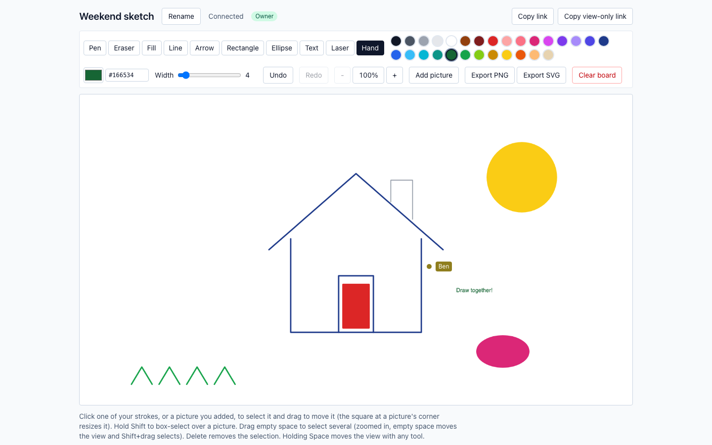
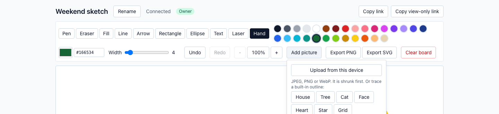
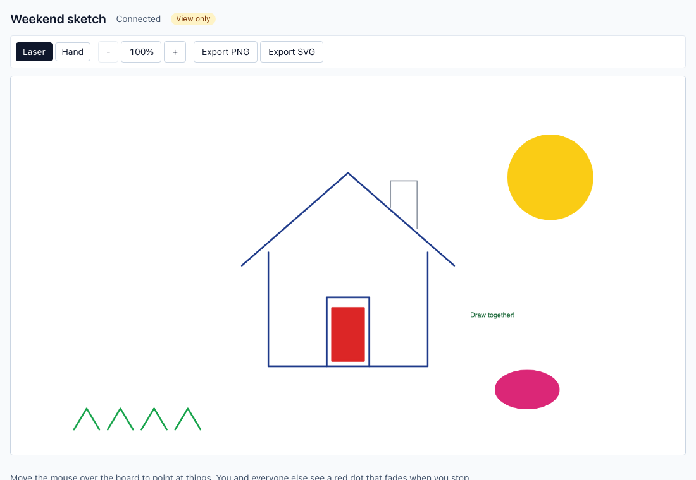
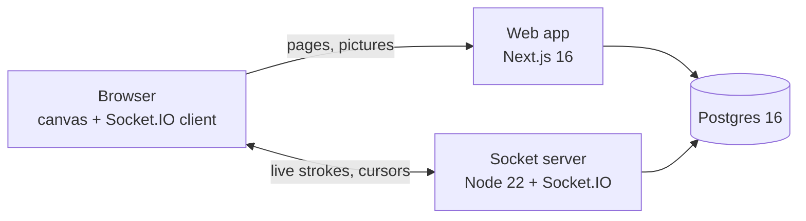
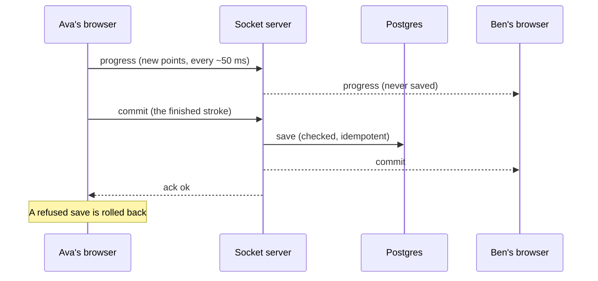

<div align="center">

# Whiteboard

**Draw together, in real time.** Share a link and everyone draws on the same canvas, live.




</div>

Someone creates a board and shares the link. Lines appear **while they are being drawn**, every person has a named, coloured cursor, and everything is saved, so a refresh, a late joiner or a server restart shows the whole board.

---

## Contents
[Highlights](#highlights) · [Quick start](#quick-start) · [Share it](#share-it-with-other-people) · [Deploy for free](#deploy-for-free) · [How it works](#how-it-works) · [Configuration](#configuration) · [Scripts](#scripts) · [Quality](#quality) · [Security](#security) · [Limits](#limits) · [Project layout](#project-layout) · [Docs](#docs)

---

## Highlights

| | |
|---|---|
| ✏️ **Draw** | Pen, eraser, line, arrow, rectangle, ellipse and text, with 28 colours, a colour wheel, a colour code box and remembered custom colours |
| 🪣 **Fill** | Click inside any closed area, even one made of several lines. Small gaps close by themselves, and a fill belongs to its shape |
| 🖼️ **Trace** | Add a picture under the drawing: upload your own, or pick a built-in outline (house, tree, cat, face, heart, star, grid) |
| ✋ **Select and move** | The Hand tool selects, moves, resizes and deletes your own strokes and pictures, with undo |
| 👥 **Together** | Live strokes, named coloured cursors, a laser pointer, undo and redo for your own work |
| 🔗 **Share** | One link to draw, a separate **view-only** link to watch, and an **owner** who can clear and rename the board |
| 🔍 **Navigate** | Zoom and pan, scroll or pinch, hold Space to move the view with any tool |
| 💾 **Export** | PNG or SVG, pictures included |
| 🛡️ **Safe by design** | Every message validated, every connection rate limited, strokes tied to their author, text always shown as text |

<table>
<tr>
<td width="50%"></td>
<td width="50%"></td>
</tr>
<tr>
<td align="center"><sub>28 colours, a colour wheel and the <b>Add picture</b> menu</sub></td>
<td align="center"><sub>The <b>view-only</b> link: watch and point, never change</sub></td>
</tr>
</table>

---

## Quick start

You need **Node 22** and **Postgres 16**.

```bash
npm ci                       # installs the exact pinned versions and generates the database client
cp .env.example .env         # then put your Postgres addresses in .env
npm run db:deploy            # creates the tables
```

Run the two parts, in two terminals:

```bash
npm run server               # socket server on :4000
npm run dev                  # web app on http://localhost:3000
```

Open <http://localhost:3000>, create a board and open the link in a second window to see it live.

> **Ports busy?** Pick others and keep the three values in `.env` in step: `SOCKET_PORT`, `CORS_ORIGIN` (the web address) and `NEXT_PUBLIC_SOCKET_URL` (the socket address). The web app learns the socket address when it is built or started.

---

## Share it with other people

A link to `localhost` only works on your own computer. To let people on the same Wi-Fi or network join:

```bash
npm run share
```

It builds the app for your computer's network address, starts both servers on it and prints the address (for example `http://192.168.1.2:3400`). **Open that address yourself, not `localhost`**, so the links you copy work for others, then send them the board link from **Copy link**, or the **Copy view-only link** button.

People must be on the same network, and your computer may ask to allow incoming connections. Stop with <kbd>Ctrl</kbd>+<kbd>C</kbd>.

For anyone anywhere, deploy it (next section) or run `npm run share:public` and expose port 3500 with a tunnel service.

---

## Deploy for free

The whole app can run as **one container behind one address**, which suits hosts that give a service a single web address. The recommended free setup is a **Render** web service plus a **Neon** Postgres database:

1. Push this repository to GitHub.
2. Create a Neon project and copy its **direct** connection string (it ends with `?sslmode=require`).
3. On Render choose **New, Blueprint**, pick the repository (it reads [`render.yaml`](render.yaml)) and paste the string as `DATABASE_URL`.

The free plans sleep after a while without visitors (about a minute to wake), but boards live in the database and are not lost. Full steps, limits and troubleshooting are in **[docs/DEPLOY.md](docs/DEPLOY.md)**.

Other ways to run it:

```bash
docker compose up --build    # database, migration, socket server and web app (set POSTGRES_PASSWORD first)
docker build -t whiteboard . # the default build target is the single-container "app" image
```

---

## How it works

Next.js cannot hold websockets on serverless hosts, so the live part is a **separate Node process**.



**A stroke's life**



- **Joining** returns the whole board in the acknowledgement, with no gap between the history and live events.
- **Strokes are rows**, saved in draw order. Progress and cursors are never saved.
- **Identity comes from the connection**, never from a message. A person's strokes are tied to a secret key their browser keeps, so knowing someone's public id is not enough to remove their work.
- **Moving** something replaces its rows with moved copies in one step, under ids the browser chose, so a retried request can never move it twice.
- **Pictures** are metadata in the join acknowledgement and bytes fetched separately from the web app, with fixed headers.

The full design, every event and every limit are in **[docs/DESIGN.md](docs/DESIGN.md)**.

<details>
<summary><b>The tools in detail</b></summary>

- **Hand (select and move):** click one of your strokes, or a picture you added, to select it and drag to move it; Shift adds to the selection; drag empty space to box-select; <kbd>Delete</kbd> removes the selection; <kbd>Ctrl</kbd>/<kbd>Cmd</kbd>+<kbd>A</kbd> selects all of yours; <kbd>Ctrl</kbd>/<kbd>Cmd</kbd>+<kbd>Z</kbd> moves things back. When zoomed in, dragging empty space moves the view and Shift+drag selects.
- **Zoom:** <kbd>Ctrl</kbd>/<kbd>Cmd</kbd> with the wheel (or a trackpad pinch) zooms; a plain scroll moves the view when zoomed in; hold <kbd>Space</kbd> and drag to move the view with any tool.
- **Fill:** inside one closed shape the fill is bound to it and moves, undoes, deletes and erases with it. In any other closed area it fills what the lines enclose. A new colour replaces the old fill.
- **Pictures:** the picture's author or the board owner can move it, resize it from the corner square, set its opacity or remove it. Other tools never touch pictures, so tracing over one cannot move it. Clearing the board keeps its pictures.
- **Laser:** you and everyone else see a red dot that fades when you stop.
- **Owner and view-only:** the creator of a board is its owner (the key lives in their browser). Anyone with the board link can draw; the view-only link cannot change anything.

</details>

---

## Configuration

Copy `.env.example` to `.env`. Nothing secret is committed.

| Variable | Meaning |
|---|---|
| `DATABASE_URL` | Postgres connection string used by both processes |
| `TEST_DATABASE_URL` | A separate database used only by the tests |
| `SOCKET_PORT` | Port of the socket server (default `4000`) |
| `CORS_ORIGIN` | The one browser address allowed to connect, for example `http://localhost:3000`. Never `*`. The word `same-origin` is for one address serving both parts |
| `NEXT_PUBLIC_SOCKET_URL` | Where the browser finds the socket server. Empty means the page's own address |
| `MAX_CONNECTIONS_PER_IP` | Connections allowed per client address (default `30`) |
| `TRUST_PROXY` | How many trusted proxies sit in front of the servers (`0` by default) |
| `METRICS_TOKEN` | When set, `/metrics` needs `Authorization: Bearer <token>` |
| `RUN_MIGRATIONS`, `DIRECT_DATABASE_URL`, `PORT` | For the single-container image: migrate at start, the direct database address for it, and the listening port |

---

## Scripts

| Command | What it does |
|---|---|
| `npm run dev` / `npm run build` / `npm start` | The web app |
| `npm run server` | The socket server (`server:dev` restarts it on changes) |
| `npm run db:deploy` / `db:migrate` | Apply migrations / create a new one while developing |
| `npm test` | Unit and server integration tests against a real Postgres |
| `npm run typecheck` / `npm run lint` | TypeScript and ESLint (with a security plugin) |
| `npm run e2e` | Builds the app and drives real Chromium windows (needs `npx playwright install chromium`) |
| `npm run probes` / `npm run xss` | Hostile-input checks against a running server / names rendered as text |
| `npm run bench` | Loopback latency benchmark (server cost only) |
| `npm run share` / `share:public` / `serve` | Serve on your network address / on one address for a tunnel / the single-address server |

---

## Quality

| Check | Result |
|---|---|
| Unit and server tests (real sockets, real Postgres) | **401** passing in 29 files |
| Browser end-to-end (two to six real Chromium windows) | **15 + 38** checks passing |
| Hostile-input probes against a running server | **13** passing |
| Deliberate breaks of the rules, each of which must fail a test | **80 of 80** caught |
| `npm audit` for production dependencies | **0** vulnerabilities |

Tests are written before the code they cover, the browser checks use real pointers and several windows at once, and the rules the product depends on were each broken on purpose to prove a test notices. The plan is in [docs/TEST_PLAN.md](docs/TEST_PLAN.md) and the results, including what was **not** tested, are in [docs/FINAL_REPORT.md](docs/FINAL_REPORT.md).

On a loopback test (one machine, server cost only, not internet latency) a live stroke reaches the other person in about 2 ms and a saved stroke is confirmed in about 8 ms at the median.

---

## Security

- **Every client message is validated** with zod, on the server, before anything else happens.
- **Identity is stamped from the connection.** A message can never name its author or its board.
- **Ownership is enforced in the database query:** removing or moving a stroke, and changing a picture, is scoped by board and author (and by the author's secret key), not by a check in the page.
- **Uploads are inspected, not trusted:** type from the file's first bytes, size, and pixel dimensions from its header. SVG and GIF are refused. Pictures are served with a fixed type, no type guessing and a locked-down policy.
- **Per-connection rate limits** (token buckets), a cap on connections per address, and a message size limit.
- **One allowed origin**, checked for websockets as well as for ordinary requests. Security headers and a content security policy on every page.
- **Names, board titles and text are always rendered as text**, never as markup. Tested with real script payloads in a real browser.
- **No secrets in the repository**; the owner key of a board is stored only as a hash.

---

## Limits

| | |
|---|---|
| Canvas | 1600 × 900 units, the same for everyone (drawn on any screen size) |
| Per stroke / per board | 5,000 points / 5,000 strokes and 500,000 points |
| Live batch | 200 points about every 50 ms |
| Names, board titles | 1 to 30 characters |
| Text | up to 200 characters |
| Pictures | 8 per board, uploads up to 400 KB each and 2.5 MB per board, at most 4,096 pixels a side |
| Largest message | 512 KB |

---

## Project layout

```
src/
  app/          pages, the create-board action, the picture route
  components/   Board (name gate) and Whiteboard (canvas, tools, sockets)
  lib/          pure, tested helpers: drawing, fill, flood fill, geometry, history, palette, export, limits
  server/       the socket server (app.ts), its entry point and the rate limiter
  shared/       the protocol, limits, picture checks and templates used by both sides
prisma/         schema and migrations
tests/          unit and server integration tests
e2e/            browser end-to-end checks
security/       hostile-input probes and the XSS proof
scripts/        share and single-address serving
docs/           design, test plan, deployment, final report, images
```

---

## Docs

| | |
|---|---|
| [DESIGN.md](docs/DESIGN.md) | Components, data model, every event and limit, and the reasons behind each choice |
| [TEST_PLAN.md](docs/TEST_PLAN.md) | What is tested at which level, and why |
| [DEPLOY.md](docs/DEPLOY.md) | Free deployment on Render and Neon, or a tunnel from your own computer |
| [FINAL_REPORT.md](docs/FINAL_REPORT.md) | What was built, what was tested, what was not, and the measured numbers |
| [UNDERSTANDING.md](docs/UNDERSTANDING.md) | The product in one page |

**Not built:** follow mode, several socket servers behind one board (it would need a shared adapter), and history paging.
